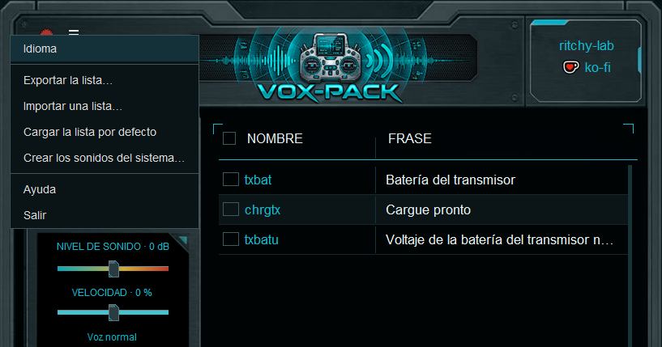

He creado traducciones de este documento basadas en IA para: 🇩🇪&nbsp;**[Deutsch](README.de.md)** · 🇬🇧&nbsp;**[English](README.md)** · 🇫🇷&nbsp;**[Français](README.fr.md)**. Con gusto corregiré cualquier error.

# EdgeTX-Voiced-TXBattery

Este es un pequeño script Lua para EdgeTX que anuncia por voz el nivel de batería del transmisor como porcentaje.  

Surgió después de hacer muchas pruebas de banco para una configuración de iNav y que la alarma de batería baja saltara durante el primer vuelo.

Me gusta activarlo al desarmar, de modo que al final del vuelo sepa cuánta batería queda disponible para el siguiente. También da un informe cuando se enciende el transmisor.

## Cómo funciona

Cuando se activa, el script lee el voltaje de la batería del transmisor y utiliza los ajustes de voltaje mínimo y máximo de batería configurados en la radio para calcular un porcentaje. Redondea y limita el resultado a 0–100 %, anuncia el porcentaje y reproduce una advertencia de batería baja por debajo del 10 %. Si el voltaje no está disponible, reproduce un aviso de que no está disponible.

## Instalación

1. Descarga o clona este repositorio y luego conecta la tarjeta SD de tu transmisor a tu ordenador (o accede a ella mediante el modo de almacenamiento masivo USB).
2. Copia `SCRIPTS/FUNCTIONS/txbatpc.lua` en la misma carpeta de la tarjeta SD, de forma que la ruta final sea:
   `SCRIPTS/FUNCTIONS/txbatpc.lua`
3. Copia la carpeta `SOUNDS/en/SCRIPTS/TXBATPC` de este repositorio en la ubicación correspondiente de la tarjeta SD. Los archivos de sonido deben quedar en:
   `SOUNDS/en/SCRIPTS/TXBATPC/`
   Mantén intactas la estructura de carpetas y los nombres de archivo. Los archivos de audio se usan para el mensaje hablado de la batería y la advertencia de batería baja.
4. Expulsa la tarjeta SD de forma segura (si procede) y reinicia el transmisor o actualiza el contenido de su tarjeta SD.
5. En los ajustes de **Funciones especiales** de tu modelo, añade una función que ejecute el script Lua `txbatpc`. Elige el interruptor/posición, establece el comportamiento de repetición/activación en x1 y marca la casilla de activación.

**NOTA: Si los archivos de sonido empiezan a reproducirse en bucle al activarse, apaga y vuelve a encender el transmisor y a partir de entonces debería funcionar correctamente.**

## Archivos de voz alternativos

Los archivos de sonido incluidos están en inglés con la voz Emily (Irlanda) acelerada un 20 %. Se eligió por ser la que mejor encaja con los archivos de sonido que incluye EdgeTX. Si quieres crear alternativas, te recomiendo usar Vox-Pack (https://github.com/ritchy-lab/Vox-Pack) 🇬🇧&nbsp;**[English&nbsp;version](https://github.com/ritchy-lab/Vox-Pack/blob/main/README.en.md)** · 🇫🇷 **[Version française](https://github.com/ritchy-lab/Vox-Pack/blob/main/README.md)** . 🇩🇪&nbsp;**[Deutsche&nbsp;Fassung](https://github.com/ritchy-lab/Vox-Pack/blob/main/README.de.md)**

### Inglés

Para crear nuevos archivos de voz:

1. Importa el archivo «en.csv» de la carpeta csv en Vox-Pack haciendo clic en el icono de menú de la esquina superior izquierda y luego en «Import a list...».

2. Selecciona la nueva voz y la velocidad.
3. Haz clic en el botón Let's Go y selecciona la carpeta de destino.

Los tres archivos de voz se generarán en la carpeta que indiques. Cópialos en la carpeta SOUNDS/en/SCRIPTS/TXBATPC/ de tu radio.

### Otros idiomas

He usado IA para generar traducciones al francés, alemán y español. Se encuentran en las rutas correspondientes de la carpeta SOUNDS. No puedo garantizar la calidad de estas traducciones, así que abre una incidencia (issue) con una traducción mejor, la voz o la velocidad que prefieras.

Para crear archivos de sonido en otro idioma:
1. Guarda en.csv con el código del nuevo idioma, p. ej. es.csv para español.
2. Edita el nuevo archivo y sustituye las cadenas de texto por las traducciones deseadas. No modifiques los nombres de archivo.
3. Importa el nuevo archivo csv en Vox-Pack.
4. Elige la nueva voz y la velocidad.
5. Haz clic en el botón Let's Go y selecciona la carpeta de destino.
6. Copia los nuevos archivos wav en la carpeta SOUNDS/<código de tu idioma>/SCRIPTS/TXBATPC/ de tu radio.

## Solución de problemas: faltan archivos de voz

- Confirma que los archivos de sonido están en la tarjeta SD en `SOUNDS/en/SCRIPTS/TXBATPC/` y que la carpeta y los nombres de archivo no se han modificado.
- El script comprueba primero la carpeta del idioma de voz configurado en la radio. Si no encuentra allí un archivo de sonido, recurre al archivo en inglés de `SOUNDS/en/SCRIPTS/TXBATPC/`.
- El script puede seguir anunciando el porcentaje mediante `playNumber` de EdgeTX; sin embargo, los mensajes personalizados y la advertencia de batería baja requieren sus archivos WAV correspondientes.
