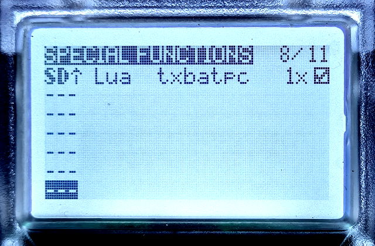
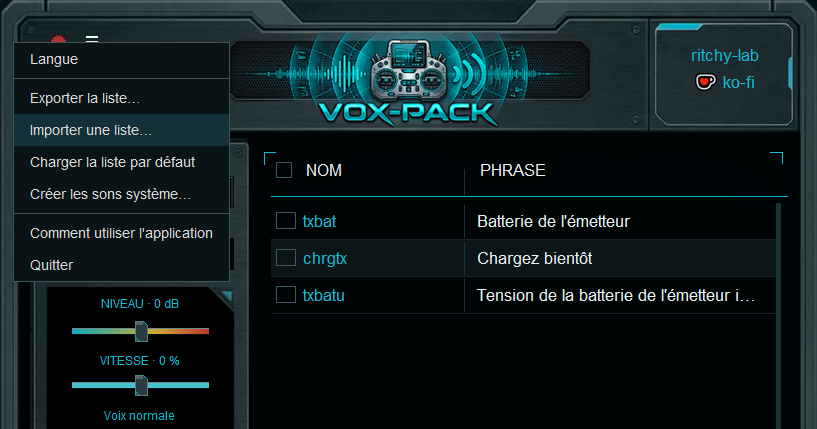

J'ai créé des traductions de ce document basées sur l'IA pour : 🇩🇪&nbsp;**[Deutsch](README.de.md)** · 🇪🇸&nbsp;**[Español](README.es.md)** · 🇬🇧&nbsp;**[English](README.md)**. Je corrigerai volontiers les éventuelles erreurs.

# EdgeTX-Voiced-TXBattery

Ceci est un petit script Lua pour EdgeTX qui annonce vocalement le niveau de batterie de l'émetteur sous forme de pourcentage.  

Il est né après de nombreux tests sur banc pour une configuration iNav, suivis d'une alarme de batterie faible qui s'est déclenchée dès le premier vol.

Je préfère le déclencher au désarmement, afin qu'à la fin du vol je sache quelle autonomie reste disponible pour le suivant. Il fournit également un rapport à la mise sous tension de l'émetteur.

## Fonctionnement

Lorsqu'il est déclenché, le script lit la tension de la batterie de l'émetteur et utilise les réglages de tension minimale et maximale de la batterie configurés dans la radio pour calculer un pourcentage. Il arrondit et limite le résultat entre 0 et 100 %, annonce le pourcentage et émet un avertissement de batterie faible en dessous de 10 %. Si la tension n'est pas disponible, il joue un message indiquant l'indisponibilité.

## Installation

1. Téléchargez ou clonez ce dépôt, puis connectez la carte SD de votre émetteur à votre ordinateur (ou accédez-y en mode stockage de masse USB).
2. Copiez `SCRIPTS/FUNCTIONS/txbatpc.lua` dans le même dossier sur la carte SD, de sorte que le chemin final soit :
   `SCRIPTS/FUNCTIONS/txbatpc.lua`
3. Copiez le dossier `SOUNDS/en/SCRIPTS/TXBATPC` de ce dépôt à l'emplacement correspondant sur la carte SD. Les fichiers son doivent se trouver dans :
   `SOUNDS/en/SCRIPTS/TXBATPC/`
   Conservez la structure des dossiers et les noms de fichiers intacts. Les fichiers audio servent à l'annonce vocale de la batterie et à l'avertissement de batterie faible.
4. Éjectez la carte SD en toute sécurité (le cas échéant) et redémarrez l'émetteur ou actualisez le contenu de sa carte SD.
5. Dans les réglages **Fonctions spéciales** de votre modèle, ajoutez une fonction qui exécute le script Lua `txbatpc`. Choisissez l'interrupteur/la position, réglez le comportement de répétition/déclenchement sur x1 et cochez la case d'activation.

**REMARQUE : si les fichiers son se mettent à jouer en boucle lors de l'activation, éteignez puis rallumez l'émetteur ; le fonctionnement devrait ensuite être normal.**

## Fichiers vocaux alternatifs

Les fichiers son fournis sont en anglais, avec la voix Emily (Irlande) accélérée de 20 %. Ce choix correspond au mieux aux fichiers son fournis par EdgeTX. Si vous souhaitez en créer d'autres, je recommande d'utiliser Vox-Pack (https://github.com/ritchy-lab/Vox-Pack) 🇬🇧&nbsp;**[English&nbsp;version](https://github.com/ritchy-lab/Vox-Pack/blob/main/README.en.md)** · 🇫🇷 **[Version française](https://github.com/ritchy-lab/Vox-Pack/blob/main/README.md)** . 🇩🇪&nbsp;**[Deutsche&nbsp;Fassung](https://github.com/ritchy-lab/Vox-Pack/blob/main/README.de.md)**

### Anglais

Pour créer de nouveaux fichiers vocaux :

1. Importez le fichier « en.csv » du dossier csv dans Vox-Pack en cliquant sur l'icône de menu en haut à gauche, puis sur « Import a list... ».

2. Sélectionnez la nouvelle voix et la vitesse.
3. Cliquez sur le bouton Let's Go et sélectionnez le dossier de destination.

Les trois fichiers vocaux seront générés dans le dossier que vous avez indiqué. Copiez-les dans le dossier SOUNDS/en/SCRIPTS/TXBATPC/ de votre radio.

### Autres langues

J'ai utilisé l'IA pour générer des traductions en français, en allemand et en espagnol. Elles se trouvent dans les chemins correspondants du dossier SOUNDS. Je ne peux pas garantir la qualité de ces traductions ; n'hésitez donc pas à ouvrir une issue avec une meilleure traduction, une voix ou une vitesse que vous préférez.

Pour créer des fichiers son dans une autre langue :
1. Enregistrez en.csv sous le code de la nouvelle langue, par ex. fr.csv pour le français.
2. Modifiez le nouveau fichier et remplacez les chaînes de texte par les traductions souhaitées. Ne modifiez pas les noms de fichiers.
3. Importez le nouveau fichier csv dans Vox-Pack.
4. Choisissez la nouvelle voix et la vitesse.
5. Cliquez sur le bouton Let's Go et sélectionnez le dossier de destination.
6. Copiez les nouveaux fichiers wav dans le dossier SOUNDS/<code de votre langue>/SCRIPTS/TXBATPC/ de votre radio.

## Dépannage : fichiers vocaux manquants

- Vérifiez que les fichiers son se trouvent sur la carte SD dans `SOUNDS/en/SCRIPTS/TXBATPC/` et que le dossier et les noms de fichiers n'ont pas été modifiés.
- Le script vérifie d'abord le dossier correspondant à la langue vocale configurée dans la radio. Si un fichier son n'y est pas trouvé, il se rabat sur le fichier anglais dans `SOUNDS/en/SCRIPTS/TXBATPC/`.
- Le script peut toujours annoncer le pourcentage grâce à la fonction `playNumber` d'EdgeTX ; les messages personnalisés et l'avertissement de batterie faible nécessitent en revanche leurs fichiers WAV respectifs.
